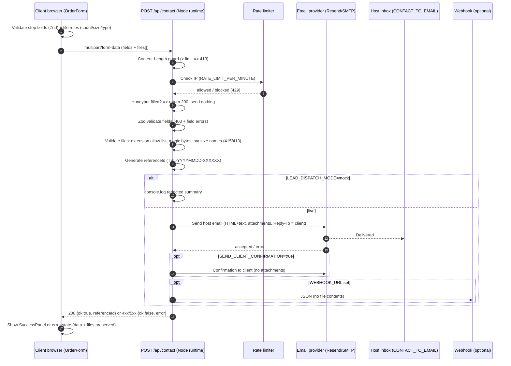

# TopSmartLLC — API & Data Flow

Version 1.0 · Implements SRS FR-030…FR-042. Service keys and option values match `SERVICE_SPECIFICATIONS.md`.

## 1. Order Request Flow (client -> host email)

Rule: a response of `ok:true` is returned only after the **host email** is accepted by the provider (live mode). Confirmation-email and webhook failures are logged (reference ID only) and do not fail the request.

## 2. Form Fields & Validation
All fields are sent as `multipart/form-data` text parts, arrays as repeated keys (`services`), files as repeated `attachments` parts.

| Field | Type | Required | Rules | Error message |
|-------|------|----------|-------|---------------|
| `name` | string | yes | trim, 2–80 chars | "Please enter your full name." |
| `email` | string | yes | valid email, max 254 | "Please enter a valid email address." |
| `phone` | string | no | optional; if present 7–20 chars of digits, spaces, `+ - ( )` | "Please enter a valid phone number." |
| `company` | string | no | max 120 | "Company name is too long." |
| `services` | enum[] | yes | 1–4 of `web`, `app`, `content`, `ebook` | "Select at least one service." |
| `budget` | enum | yes | `under-1k` `1k-5k` `5k-15k` `15k-50k` `50k-plus` `not-sure` | "Please choose a budget range." |
| `timeline` | enum | yes | `asap` `1-month` `1-3-months` `flexible` | "Please choose a timeline." |
| `description` | string | yes | trim, 20–5000 chars | "Tell us a bit more (at least 20 characters)." |
| `links` | string | no | max 1000; free text of reference/share links (Drive, Dropbox, WeTransfer, existing site) | "Links are too long." |
| `estimateSummary` | string | no | max 2000; set by calculator | (hidden) |
| `consent` | boolean | yes | must be `true` | "Please accept the privacy terms to continue." |
| `website` (honeypot) | string | no | must be empty; visually hidden, `tabindex=-1`, `autocomplete=off`, `aria-hidden` | (silent) |
| `source` | string | no | `contact` `calculator` `service-page` (analytics context) | (n/a) |
| `attachments` | File[] | no | 0–5 files, total <= `MAX_UPLOAD_MB` (default 4 MB), see section 3 | per-file messages below |

File error messages: "{name} isn't an allowed file type." · "You can attach up to 5 files." · "Attachments must be 4 MB or less in total. Share larger files with a link instead." · "{name} appears to be corrupted or isn't what its extension says."

## 3. Attachment Rules
- Allowed extensions -> expected magic bytes/MIME family:
  `pdf` (%PDF) · `png` · `jpg/jpeg` · `gif` · `webp` (RIFF…WEBP) · `doc/xls/ppt` (OLE2 D0CF11E0) · `docx/xlsx/pptx/zip` (PK 0x504B) · `txt/csv/rtf` (text; reject if contains NUL bytes; rtf starts with `{\rtf`).
- Rejected: executables and scripts (`exe`, `msi`, `bat`, `cmd`, `sh`, `js`, `vbs`, `ps1`, `jar`, `apk`, `dmg`, `html`, `svg`, etc.) and any extension not in the allow-list.
- Max 5 files, total size <= `MAX_UPLOAD_MB` MB (default 4, hard ceiling 4.5 MB due to Vercel serverless body limit; raise only on self-hosted/Docker).
- File names sanitized: strip path separators and control characters, collapse spaces, max 100 chars, keep extension; duplicates suffixed `-2`, `-3`.
- Files are read into memory, validated and passed to the email provider as attachments. Never written to disk, never logged, never executed. `zip` files are not opened; the host email warns "Archives are not scanned — open with care."
- Same limits are enforced in the browser (`useFileUpload`) for fast feedback and again on the server.

## 4. Data Model
```ts
export type ServiceKey = 'web' | 'app' | 'content' | 'ebook';
export type BudgetKey = 'under-1k' | '1k-5k' | '5k-15k' | '15k-50k' | '50k-plus' | 'not-sure';
export type TimelineKey = 'asap' | '1-month' | '1-3-months' | 'flexible';

export interface LeadInput {
  name: string;
  email: string;
  phone?: string;
  company?: string;
  services: ServiceKey[];
  budget: BudgetKey;
  timeline: TimelineKey;
  description: string;
  links?: string;
  estimateSummary?: string;
  consent: true;
  website?: string;            // honeypot, must be empty
  source?: 'contact' | 'calculator' | 'service-page';
}

export interface LeadRecord extends Omit<LeadInput, 'website' | 'consent'> {
  referenceId: string;         // TSL-YYYYMMDD-XXXXXX
  receivedAt: string;          // ISO 8601 UTC
  consentAt: string;           // ISO 8601 UTC
  attachments: { filename: string; sizeBytes: number; contentType: string }[];
  ip?: string;                 // hashed in logs; host email shows the raw IP only if SHOW_IP_IN_EMAIL=true
}
```
JSON Schema (fields part; files are multipart parts):
```json
{
  "$schema": "https://json-schema.org/draft/2020-12/schema",
  "title": "LeadInput",
  "type": "object",
  "required": ["name", "email", "services", "budget", "timeline", "description", "consent"],
  "additionalProperties": false,
  "properties": {
    "name": { "type": "string", "minLength": 2, "maxLength": 80 },
    "email": { "type": "string", "format": "email", "maxLength": 254 },
    "phone": { "type": "string", "pattern": "^[0-9+()\\-\\s]{7,20}$" },
    "company": { "type": "string", "maxLength": 120 },
    "services": { "type": "array", "minItems": 1, "maxItems": 4, "uniqueItems": true,
      "items": { "enum": ["web", "app", "content", "ebook"] } },
    "budget": { "enum": ["under-1k", "1k-5k", "5k-15k", "15k-50k", "50k-plus", "not-sure"] },
    "timeline": { "enum": ["asap", "1-month", "1-3-months", "flexible"] },
    "description": { "type": "string", "minLength": 20, "maxLength": 5000 },
    "links": { "type": "string", "maxLength": 1000 },
    "estimateSummary": { "type": "string", "maxLength": 2000 },
    "consent": { "const": true },
    "website": { "type": "string", "maxLength": 0 },
    "source": { "enum": ["contact", "calculator", "service-page"] }
  }
}
```

## 5. API Contract — `POST /api/contact`
**Request:** `Content-Type: multipart/form-data` (fields from section 2, files in repeated `attachments`).

**200 OK**
```json
{ "ok": true, "referenceId": "TSL-20261109-A7K2QX", "attachmentsReceived": 2 }
```
**400 Bad Request** (validation)
```json
{ "ok": false, "error": { "code": "VALIDATION_ERROR", "message": "Please fix the highlighted fields.",
  "fields": { "email": "Please enter a valid email address.", "services": "Select at least one service." } } }
```
**413 Payload Too Large** `{ "ok": false, "error": { "code": "PAYLOAD_TOO_LARGE", "message": "Attachments must be 4 MB or less in total. Share larger files with a link instead." } }`
**415 Unsupported Media Type** `{ "ok": false, "error": { "code": "FILE_TYPE_NOT_ALLOWED", "message": "report.exe isn't an allowed file type.", "fields": { "attachments": "…" } } }`
**429 Too Many Requests** `{ "ok": false, "error": { "code": "RATE_LIMITED", "message": "Too many requests. Please wait a minute and try again." } }` + `Retry-After` header.
**500/502** `{ "ok": false, "error": { "code": "DISPATCH_FAILED", "message": "We couldn't send your request. Please try again or email hello@topsmartllc.com." } }`
(500 = unexpected server error, 502 = email provider rejected/unavailable.)

Honeypot filled: respond **200** with a normal-looking body and send nothing.
Headers: `Cache-Control: no-store`. CORS: same-origin only (no CORS headers). Method other than POST -> 405.

## 6. Email Specification
**To:** `CONTACT_TO_EMAIL` · **From:** `TopSmartLLC Website <CONTACT_FROM_EMAIL>` · **Reply-To:** `name <client email>`
**Subject:** `[New Order Request] {name} — {services joined by ", "} — {budget label} — {referenceId}`
**Body (HTML + plain text):** reference ID, received time (UTC and host-friendly), Contact block (name, email as mailto, phone as tel, company), Project block (services, budget, timeline), Description (preserve line breaks, HTML-escaped), Links, Estimate summary, Attachments list (name, size, type) with archive warning, Consent line (accepted at timestamp), Source. All user content is HTML-escaped; links are not auto-linked unless `http(s)`; the HTML is table-based and inline-styled for email clients.
**Attachments:** each validated file with its sanitized name and original content type.
**Client confirmation (if enabled):** To client; subject `We received your request ({referenceId})`; recap of services, what happens next (reply within 1 business day), and the host's contact details. No attachments.
**Webhook (if `WEBHOOK_URL`):** `POST` JSON `LeadRecord` (attachments metadata only) plus a one-line `text` summary so it also works as a Slack incoming webhook. 5s timeout, 1 retry, failures logged by reference id only.

**Delivery order and failure rules (implemented in `src/lib/email/dispatch.ts`):**
1. The host email is the lead. If the provider rejects it or is unreachable, the request fails (502) and nothing else is sent.
2. Only after the host email is accepted are the client confirmation and the webhook attempted, together. Either can fail without failing the request; the failure is logged with the reference id and no personal data.
3. Visitor-facing errors never include provider messages or secrets; those go to the server log only.

**Providers:** Resend is called directly over HTTPS (`POST /emails`; `from`, `to`, `reply_to`, `subject`, `html`, `text`, `attachments[].filename|content` as base64), so no SDK is needed. SMTP uses `nodemailer`. Resend's `reply_to` field name was not stated in the docs page consulted, so confirm Reply-To in the first live test (see the deployment checklist).

**Development helper:** `GET /api/dev/email-preview?type=host|client|text` renders the emails with sample data. It returns 404 in production.

## 7. Dispatch Modes
| Mode | Behaviour |
|------|-----------|
| `LEAD_DISPATCH_MODE=mock` (default in dev) | Full validation runs; no email/webhook sent; logs `[mock-dispatch] {referenceId, services, attachments:[name,size]}` with name/email/phone/description redacted; returns the same success response |
| `LEAD_DISPATCH_MODE=live` | Validates env at startup (`CONTACT_TO_EMAIL`, `CONTACT_FROM_EMAIL`, and `RESEND_API_KEY` or SMTP_*); sends email; fails fast with a clear error if config is missing |

`EMAIL_PROVIDER=resend|smtp` (default `resend`). SMTP vars: `SMTP_HOST`, `SMTP_PORT`, `SMTP_USER`, `SMTP_PASS`, `SMTP_SECURE`.

## 8. Rate Limiting
In-memory sliding window per IP (`x-forwarded-for` first hop): `RATE_LIMIT_PER_MINUTE` (default 5). Resets on cold start (acceptable for v1; upgrade path: Upstash Redis / Vercel KV). Additional guards: reject bodies larger than limit before parsing; max field lengths; `maxDuration = 30`.

## 9. Client Behaviour
- Submit disabled while sending; button label "Sending your request…"; progress text for uploads.
- On 400: map `fields` to inline errors and focus the first one. On 413/415: show error under the dropzone. On 429/5xx: global alert with retry; data and files stay.
- On success: clear draft from `sessionStorage`, show `SuccessPanel` (reference ID, summary, next steps), move focus to its heading, announce via `role="status"`.

## 10. Newsletter Mini-form (footer)
Decision: **hidden in v1** unless a provider is chosen. If enabled later it posts `{email, consent}` to `/api/newsletter`, which forwards a short notice email to the host. It is out of scope for the order pipeline.

## 11. Data Privacy
- No lead data stored in a database or on disk; the host's mailbox (and the email provider's delivery logs) is the only record. Disclosed in `/privacy`.
- Consent is mandatory; timestamp included in the email.
- Live logs contain no PII or file content: reference ID, status, timing, attachment count only.
- Third parties: email provider (Resend/SMTP host) and optional webhook target; both named in the Privacy Policy.
- Retention and deletion: the host deletes emails on request; contact route in Privacy Policy.
- Attachments are treated as confidential; not scanned, not opened, not stored.
