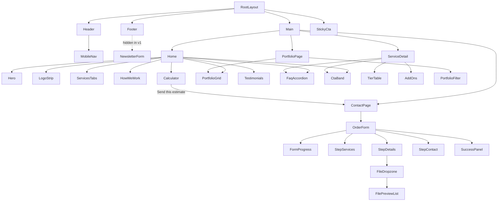

# TopSmartLLC — Architecture

Version 1.0 · Implements `SRS.md`. Styling per `DESIGN_SYSTEM.md`. API per `API_AND_DATA_FLOW.md`.

## 1. Tech Stack & Justification
| Layer | Choice | Why |
|-------|--------|-----|
| Framework | Next.js 14+ App Router, React Server Components | Static/hybrid rendering = HTML in first response (SEO, LCP), per-route metadata, built-in image/font optimization, Route Handlers for the order API in the same repo |
| Language | TypeScript (strict) | Shared types between form, API and data |
| Styling | Tailwind CSS + CSS variable tokens | Small CSS, consistent design tokens, dark mode via variables |
| Forms | React Hook Form + Zod (`@hookform/resolvers`) | Minimal re-renders; one schema validates client and server |
| Motion | CSS transitions + IntersectionObserver (`Reveal`) | Accessible entrance animation without an animation library (keeps Home JS small); honors `prefers-reduced-motion` |
| Email | Resend SDK (default) or Nodemailer SMTP | Attachments supported; provider chosen by `EMAIL_PROVIDER` |
| Tests | Vitest + Testing Library | Calculator, schemas, API handler |
| Hosting | Vercel (Netlify/Docker alternatives) | Zero-config Next.js |

**Why not a Vite SPA or plain HTML?** A client-rendered SPA ships an empty shell (weaker SEO, slower LCP, more JS) and needs a separate backend for the order API. Plain HTML lacks components, typed data and a server endpoint for email with attachments, and becomes costly to maintain across 15+ pages.

## 2. Directory & File Tree
```
TopSmartLLC/
├─ CLAUDE.md
├─ docs/                      (this documentation)
├─ public/
│  ├─ images/  (og-default.png, portfolio/*.svg, logos/*.svg)
│  ├─ icons/   (favicon.ico, apple-touch-icon.png)
│  └─ (robots/sitemap generated by app routes)
├─ src/
│  ├─ app/
│  │  ├─ layout.tsx            root layout, fonts, metadata, header/footer
│  │  ├─ page.tsx              Home
│  │  ├─ globals.css           tokens + Tailwind layers
│  │  ├─ not-found.tsx         404
│  │  ├─ sitemap.ts · robots.ts
│  │  ├─ services/page.tsx · services/[slug]/page.tsx
│  │  ├─ portfolio/page.tsx · portfolio/[slug]/page.tsx
│  │  ├─ pricing/page.tsx · about/page.tsx · contact/page.tsx
│  │  ├─ privacy/page.tsx · terms/page.tsx · cookies/page.tsx
│  │  └─ api/contact/route.ts  POST order request (multipart)
│  ├─ components/
│  │  ├─ layout/    Header, MobileNav, Footer, SkipLink, StickyCta
│  │  ├─ sections/  Hero, ServicesTabs, ServiceCard, HowWeWork, Stats, LogoStrip,
│  │  │             PortfolioGrid, PortfolioFilter, Testimonials, FaqAccordion, CtaBand, Calculator
│  │  ├─ forms/     OrderForm, StepServices, StepDetails, StepContact, FileDropzone,
│  │  │             FilePreviewList, FormProgress, NewsletterForm, SuccessPanel
│  │  └─ ui/        Button, Card, Input, Textarea, Select, Checkbox, Badge, Modal, Tabs, Accordion, Toast, Icon
│  ├─ data/         site.ts, services.ts, pricing.ts, portfolio.ts, testimonials.ts, faqs.ts
│  ├─ hooks/        useEstimate.ts, useFileUpload.ts, useDraft.ts, useReducedMotion.ts
│  ├─ lib/
│  │  ├─ schemas/   lead.ts (Zod), files.ts (limits + allow-list)
│  │  ├─ email/     transport.ts (resend|smtp), templates.ts (host + client HTML/text), dispatch.ts
│  │  ├─ rate-limit.ts · sanitize.ts · magic-bytes.ts · reference-id.ts
│  │  ├─ seo.ts (metadata + JSON-LD builders) · format.ts (currency)
│  │  └─ env.ts (validated server env via Zod)
│  ├─ types/        service.ts, portfolio.ts, lead.ts, pricing.ts
│  └─ tests/        estimate.test.ts, lead-schema.test.ts, contact-route.test.ts
├─ .env.example · next.config.mjs · tailwind.config.ts · tsconfig.json
├─ .eslintrc.json · .prettierrc · vitest.config.ts · Dockerfile (optional)
```
Routes (authoritative): `/`, `/services`, `/services/[slug]`, `/portfolio`, `/portfolio/[slug]`, `/pricing`, `/about`, `/contact`, `/privacy`, `/terms`, `/cookies`, `/api/contact`.
Service slugs: `web-design-development`, `mobile-app-development`, `content-writing-copywriting`, `ebook-creation-publishing`.

## 3. Component Hierarchy

Server Components by default; Client Components only where state/interaction is needed: MobileNav, ServicesTabs, Calculator, OrderForm (+ children), PortfolioFilter, Testimonials, Accordion, Stats counters.

## 4. State Management
- Local component state and React Hook Form for the order form (steps held in a `useReducer`-style step index).
- URL search params: portfolio `?category=`; contact pre-fill `?services=web-design-development,...&source=calculator`.
- Calculator state in `useEstimate` (pure reducer + derived memo values). On "Send this estimate" it writes `{services, summary}` to `sessionStorage` key `tsl.estimate` and navigates to `/contact`.
- Order draft (text fields only) in `sessionStorage` key `tsl.draft`; files are never persisted.
- No global store (no cross-tree shared mutable state needed). Revisit only if justified in this doc.

## 5. Styling Architecture
- Tokens defined in `globals.css` under `:root` and `[data-theme="dark"]` / `@media (prefers-color-scheme: dark)`; values from `DESIGN_SYSTEM.md`.
- `tailwind.config.ts` maps tokens (`colors.brand = "var(--brand)"`, radius, shadow, font families, container, screens).
- Theme: follows system preference; manual toggle optional (stored in localStorage after consent-free, functional use). Avoid flash with an inline pre-hydration script.
- Fonts: `next/font/google` Sora (headings) + Inter (body), subsets latin, `display: swap`.
- Utilities: `cn()` helper (clsx + tailwind-merge). No CSS-in-JS.

## 6. Asset Strategy
- `next/image` for all raster images with explicit `width/height` or `fill`+`sizes`, `priority` only for the LCP element (hero is image-free so none by default), blur placeholders.
- Icons as inline SVG React components (tree-shaken).
- Portfolio placeholders: generated SVG/gradient files in `public/images/portfolio/`.
- Lazy load below-the-fold sections with `next/dynamic` (Calculator, Testimonials, Portfolio).
- OG image: static `public/images/og-default.png` (1200x630).

## 7. Order Request Pipeline (summary; detail in API doc)
Client: RHF + Zod validation -> `FormData` (fields + files) -> `fetch('/api/contact')`.
Server (`route.ts`, Node.js runtime, `export const runtime = 'nodejs'`, `maxDuration = 30`):
1. Content-length guard -> parse `formData()` -> honeypot -> rate limit.
2. Zod validate fields -> validate files (count, size, extension allow-list, magic bytes, sanitized names).
3. Build reference ID -> render host email (HTML+text) -> attach files (Buffers) -> send via transport.
4. Optional client confirmation + optional webhook (non-blocking, failures logged but do not fail the request after host email succeeded).
5. Return JSON `{ ok, referenceId }`. If host email fails -> 502 with `{ ok:false, error }`.
Mock mode logs a redacted summary and returns success.

## 8. Cross-cutting
- **Security headers** in `next.config.mjs` `headers()`: CSP (self + Vercel analytics only if enabled), HSTS, X-Content-Type-Options, Referrer-Policy `strict-origin-when-cross-origin`, Permissions-Policy (camera/mic/geo off), X-Frame-Options DENY.
- **Env validation** at server start via `lib/env.ts`; missing live-mode vars fail fast with clear messages.
- **SEO**: `lib/seo.ts` builds `Metadata` and JSON-LD; `sitemap.ts` enumerates static routes + slugs.
- **Error handling**: `error.tsx` boundaries, `not-found.tsx`, API returns typed error format.
- **Observability**: console logs of reference ID/status only; Vercel logs; optional Sentry later.

## 9. Coding Conventions
- Files: components `PascalCase.tsx`; hooks `useCamelCase.ts`; utilities/data `kebab-case.ts` or `camelCase.ts` consistently as listed above; routes lowercase.
- Named exports for components; default exports only where Next requires (pages, layouts, route files).
- Types over interfaces for unions; interfaces for object shapes that are extended. No `any`.
- Imports use `@/*`; order: react/next, third-party, `@/` internal, relative, styles.
- Props typed explicitly; no prop drilling beyond two levels (use composition).
- Tailwind classes sorted by prettier-plugin-tailwindcss. No inline styles except dynamic values.
- Every interactive element has an accessible name; every image has alt.
- Commit style: Conventional Commits (`feat:`, `fix:`, `docs:`, `chore:`).
- Tests co-located in `src/tests` mirroring `lib/` and `hooks/`.
